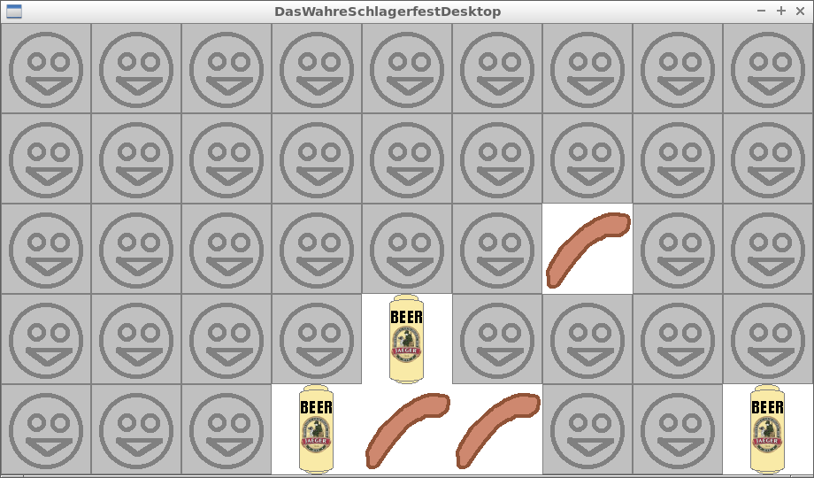

# Das Wahre Schlagerfest

Das Wahre Schlagerfest is a Truly Fun Game with an Oktoberfest theme,
programmed in C++ using Qt (see 'About the program' for more details).

[Play it in your web browser](play.md)!

## About the program

Das Wahre Schlagerfest is programmed in C++17 using the STL and [Qt 6](http://www.qt.io) libraries.

To work on the game in Qt Creator, open `das_wahre_schlagerfest.pro`.

There is a desktop version and a WebAssembly version,
see the `Build` workflow in `.github/workflows/build.yaml` for how to build these.

## I want to contribute

Awesome!

You can collaborate by

* email richelbilderbeek (at [Richel Bilderbeek's webpage its 'Contact Me' section](http://www.richelbilderbeek.nl/Contact.htm))
* add a GitHub issue: this can be a question, suggestion, or whatever
* fork this repository, make the changes, and submit a pull request.

* [Screenshots](screenshots/README.md)

## External links

* [Richel Bilderbeek's games](https://github.com/richelbilderbeek/Games)
